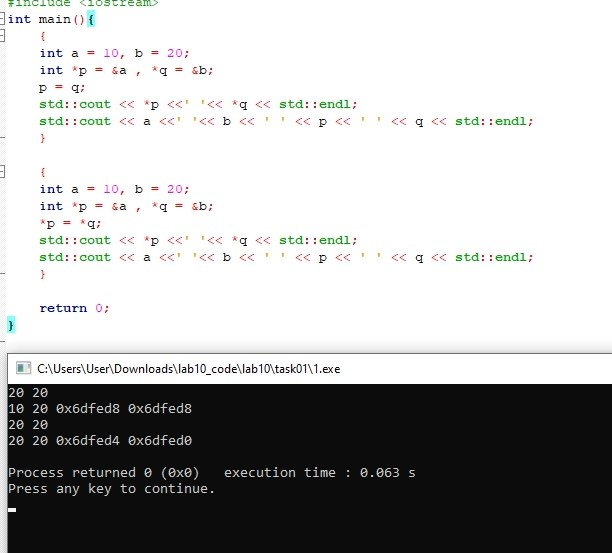
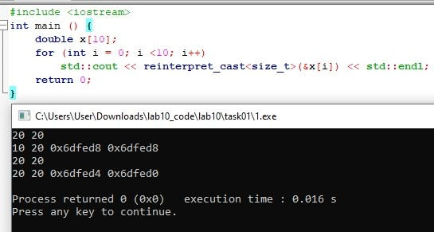

# Языки программирования
## Лабораторная работа 10

### Задание 1 **(2)**

*Рассмотрим следующие фрагменты программ.*
```
int a = 10, b = 20;
int *p = &a , *q = &b;
p = q
std::cout << *p <<' '<< *q << std::endl;
```
```
int a = 10, b = 20;
int *p = &a , *q = &b;
*p = *q
std::cout << *p <<' '<< *q << std::endl;
```
*Чем различаются присваивания в третьей строке? Что можно вывести,
чтобы показать различия?*

*Примеры программ сохраните в папке с номером задания.*

**РЕШЕНИЕ**

**В чём различие.**

- `p = q;` присваивает друг другу **указатели**, то есть адреса. После этого `p` указывает туда же, куда и `q`, то есть на `b`. Сами переменные не меняются: `a` осталось 10, `b` осталось 20.
- `*p = *q;` присваивает **значения**. Берётся значение, на которое указывает `q` (это `b`, то есть 20), и записывается туда, куда указывает `p` (это `a`). Указатели остались на своих местах (`p` на `a`, `q` на `b`), а вот `a` стало 20.

Первая строка вывода (`*p` и `*q`) в обоих вариантах одинаковая: `20 20`, поэтому по ней разницу не увидеть. Чтобы показать различие, достаточно вывести ещё:

1. сами переменные `a` и `b`: в первом варианте `10 20`, во втором `20 20`;
2. адреса `p` и `q` или результат `p == q`: в первом варианте указатели равны (`1`), во втором нет (`0`).


----

### Задание 2 **(1)**

*Рассмотрим следующую программу.* 
```
double x[10];
for (int i = 0; i <1 0; i++)
    std::cout << &x[i] << std::endl;
```
*Что она выводит? Измените
вывод так, чтобы адреса выводились в десятичной системе счисления.
Объясните почему числа составляют арифметическую прогрессию с
определенным шагом.*

*Записанную программу сохраните в папке с номером задания.*

**РЕШЕНИЕ**


---

### Задание 3 **(2)**

*Токен* **«*»** *в языке C++ может использоваться в трех различных
случаях. Аналогично токен* **«&»** *также может использоваться в трех
случаях. Приведите пример одной программы в которой они были бы
использованы во всех случаях.*

*Записанную программу сохраните в папке с номером задания.*

### Задание 4 **(2)**

*Выпишите значения всех переменных, в том числе указателей,
после выполнения каждой инструкции программы. Объясните, что
происходит в результате выполнения каждой инструкции.*
```
unsigned a = 8, b = 3 ,c = 17;
unsigned *p = &a;
unsigned *q = &b;
*p += *q + c;
c = *q;
p = &c;
c += a;
*p += 10;
*q = *p;
q = p ;
*q += 10;
```

**РЕШЕНИЕ**

Значения после каждой инструкции (запись `&a` значит «указатель хранит адрес переменной `a`»):

| № | Инструкция | a | b | c | p | q |
|---|---|---|---|---|---|---|
| 1 | `unsigned a = 8, b = 3, c = 17;` | 8 | 3 | 17 | не задан | не задан |
| 2 | `unsigned *p = &a;` | 8 | 3 | 17 | &a | не задан |
| 3 | `unsigned *q = &b;` | 8 | 3 | 17 | &a | &b |
| 4 | `*p += *q + c;` | 28 | 3 | 17 | &a | &b |
| 5 | `c = *q;` | 28 | 3 | 3 | &a | &b |
| 6 | `p = &c;` | 28 | 3 | 3 | &c | &b |
| 7 | `c += a;` | 28 | 3 | 31 | &c | &b |
| 8 | `*p += 10;` | 28 | 3 | 41 | &c | &b |
| 9 | `*q = *p;` | 28 | 41 | 41 | &c | &b |
| 10 | `q = p;` | 28 | 41 | 41 | &c | &c |
| 11 | `*q += 10;` | 28 | 41 | 51 | &c | &c |

Что происходит на каждом шаге:

1. Создаются три переменные с начальными значениями.
2. `p` получает адрес `a`, то есть указывает на `a`.
3. `q` получает адрес `b`.
4. `*p` это `a`, `*q` это `b`. Получается `a = a + (b + c) = 8 + 3 + 17 = 28`.
5. В `c` записывается значение, на которое указывает `q`, то есть значение `b`: `c = 3`.
6. Меняется сам указатель: теперь `p` указывает на `c`. Значения переменных не меняются.
7. `c = c + a = 3 + 28 = 31`.
8. `p` указывает на `c`, поэтому `c = 31 + 10 = 41`.
9. `q` указывает на `b`, `p` на `c`. В `b` записывается значение `c`: `b = 41`.
10. Указатель `q` теперь тоже указывает на `c`. Значения не меняются.
11. `q` указывает на `c`, поэтому `c = 41 + 10 = 51`.

Итог: `a = 28`, `b = 41`, `c = 51`, а `p` и `q` оба указывают на `c`.

### Задание 5 **(1)**

*Что сравнивается в приведенной ниже программе? Как можно
изменить первую строчку программы, чтобы результат тоже
изменился?*
```
int x = 1, y = 2;
int *p = &y, *q = &x;
if (p < q)
    std::cout << "Yes";
else
    std::cout << "No";
```
**РЕШЕНИЕ**

**Что сравнивается.** Сравниваются не числа `x` и `y`, а **адреса** переменных: `p` хранит адрес `y`, `q` хранит адрес `x`, значит проверяется `&y < &x`. У меня получилось:

```
&y = 0x7ffd012ebb94
&x = 0x7ffd012ebb90
No
```

То есть `y` лежит в памяти по большему адресу, чем `x`, и вывод `No`.

**Как изменить первую строку, чтобы результат поменялся.** Можно объявить переменные в другом порядке:

```cpp
int y = 2, x = 1;
```

Тогда компилятор разместит их по-другому, и у меня получилось:

```
&y = 0x7fff7f278d70
&x = 0x7fff7f278d74
Yes
```


---
### Задание 6 **(2)**

*Объясните работу следующей программы. Как изменится
результат, если тип* **double** *изменить на некоторый другой, например*
**int** *или* **char**?
```
double x = 0;
double *d = &x;
std::cout << reinterpret_cast<size_t>(d + 4) - reinterpret_cast<size_t>(d - 4) << std::endl;
```

### Задание 7 **(2)**

*Объясните работу следующей программы. Как изменится
результат, если тип* **double** *изменить на некоторый другой, например*
**int** *или* **char**?
```
std::cout << reinterpret_cast <double*>(3000) - reinterpret_cast <double*>(2000) << std::endl;
```

**РЕШЕНИЕ**

Вывод:

```
125
```

Здесь из чисел 3000 и 2000 делаются указатели на `double` (к этим адресам мы не обращаемся, просто используем их как числа). Разность двух указателей одного типа это число **элементов** между ними, а не байтов. Между адресами 2000 и 3000 лежит 1000 байт, а один `double` занимает 8 байт, поэтому `1000 / 8 = 125`.

Если поменять тип:

| Тип | sizeof | Результат |
|---|---|---|
| `double` | 8 | 125 |
| `int` | 4 | 250 |
| `char` | 1 | 1000 |

### Задание 8 **(2)**

*Что надо дописать в записанной ниже программе вместо многоточий, чтобы
она выводила все числа из массива* **a**? *Почему?*
```
int a[20];
for ( int i = 0; i < 20; i++)
    a[i] = i;
int *b=a + 8;
for (int i =...; i <...; i++)
    std::cout << b[i] <<' ';
```

**РЕШЕНИЕ**

Нужно вписать `-8` и `12`:

```cpp
int a[20];
for ( int i = 0; i < 20; i++)
    a[i] = i;
int *b = a + 8;
for (int i = -8; i < 12; i++)
    std::cout << b[i] << ' ';
```

Вывод:

```
0 1 2 3 4 5 6 7 8 9 10 11 12 13 14 15 16 17 18 19
```

**Почему так.** Указатель `b = a + 8` указывает на элемент `a[8]`. Запись `b[i]` означает то же самое, что `*(b + i)`, то есть элемент, который на `i` позиций дальше от `b`. Поэтому `b[0]` это `a[8]`, а в общем случае `b[i]` это `a[8 + i]`.

- Чтобы дойти до начала массива `a[0]`, нужно `8 + i = 0`, то есть `i = -8`. Да, индекс может быть отрицательным, если указатель стоит в середине массива.
- Последний элемент `a[19]`: `8 + i = 19`, значит `i = 11`. Условие `i < 12` как раз включает 11.

### Задание 9 **(2)**

*Что выводит следующая программа? Изменится ли результат если
изменить тип элементов массива?*

```
int a[10];
std::cout << &a[8] - &a[3] << std::endl;
```
**Решение**

Вывод:

```
5
```

Разность указателей даёт число элементов между ними: `8 - 3 = 5`. Если изменить тип элементов, результат **не изменится**. Проверил для `int`, `double` и `char`, везде получилось 5. Дело в том, что при вычитании указателей компилятор сам делит разность адресов в байтах на размер элемента, поэтому на выходе всегда число элементов. 
### Задание 10 **(1)**

*Есть ли разница между инициализацией* **p** и **q** *в следующей программе? Обоснуйте ответ.*
```
int x [10]={1, 2, 3, 4, 5, 6, 7, 8, 9, 10};
int *p = x + 5;
int *q = &x[5];
```

### Задание 11 **(3)**

*Указатели можно использовать для итерации по массивам.
Напишите программу, которая найдет сумму элементов массива,
используя указатели. В начале цикла указатель требуется установить
на начало массива, в конце каждой итерации смещать его к
следующему элементу массива через инкремент. Для выхода из цикла
надо проверять, что указатель дошел до конца массива.*
```
int x [10]={1, 2, 3, 4, 5, 6, 7, 8, 9, 10};
int s = 0;
for (int *p = ...; ...; ...)
    s += ...
std::cout << s;
```

*Записанную программу сохраните в папке с номером задания.*


## Дополнительные задания

### Задание 1 **(3)**

*Запишите программу на С++, в которой будет создаваться двумерный массив* **x[10][10]**. *Выведите адреса элементов массива и нарисуйте, как элементы расположены в памяти.*

### Задание 2 **(3)**

*Запишите программу на С++, в которой будет создаваться двумерный массив* **x[10][10]**. *Проверьте, что произойдет при различных выходах за границы массива. Напишите программы для демонстрации и поясните
их работу.* 

### Задание 3 **(6)**
*Напишите пример программы, которая продемонстрирует неопределенное поведение при выходе за границу одномерного массива. Например, чтобы программа зависла, хотя по алгоритму такого не должно произойти

### Задание 4 **(8)**
*Изучите самостоятельно работу с динамической памятью. Напишите примеры программ, демонстрирующие особенности работы (например, перемещение при расширении) и возможные ошибки при работе с памятью.* 

