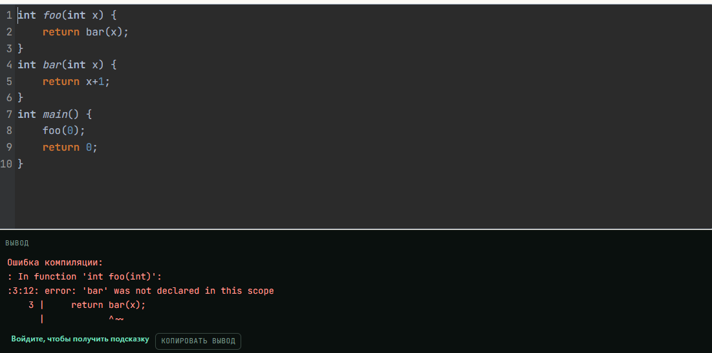

# Языки программирования
## Лабораторная работа 11

### Задание 1 **(2)**

*Что надо дописать в приведенный пример программы, чтобы она транслировалась без ошибок?
Существующий код нельзя изменять или переставлять.*

```
int foo(int x) {
    return bar(x);
}
int bar(int x) {
    return x+1;
}
int main() {
    foo(0);
    return 0;
}
```

**Решение**



```cpp
int bar(int x);

int foo(int x) {
    return bar(x);
}
int bar(int x) {
    return x+1;
}
int main() {
    foo(0);
    return 0;
}
```

Компилятор читает файл сверху вниз. Когда он доходит до строки `return bar(x);` в функции `foo`, функции `bar` он ещё не видел, поэтому выдаёт ошибку (так выглядит сообщение g++ для исходного кода):

```
error: 'bar' was not declared in this scope
```

Переставлять функции нельзя, поэтому в начало добавляется **объявление** (прототип) функции: `int bar(int x);`. Оно сообщает компилятору имя функции, тип результата и типы параметров, а само тело функции остаётся ниже, где оно и было. После этого `foo` может вызывать `bar`. Имя параметра в объявлении можно не писать, достаточно `int bar(int);`.

### Задание 2 **(1)**

*Функция* **dswap** *должна была обменивать значения своих параметров.* 
*(На выводе должно было получиться* ```3.4 1.5```.)
*В чем ошибка при написании этой функции? Как ее исправить? 
Что передавалось в параметры у исходной функции и у исправленной?* 
```
#include <iostream>
void dswap(double x, double y) {
   double t = x;
   x = y;
   y = t;
}
int main(void) {
   double x = 1.5, y = 3.4;
   dswap(x, y);
   std::cout << x << " " << y << std::endl;
   return 0;
}
```

**Решение**

```cpp
#include <iostream>

void dswap(double &x, double &y) {
   double t = x;
   x = y;
   y = t;
}

int main(void) {
   double x = 1.5, y = 3.4;
   dswap(x, y);
   std::cout << x << " " << y << std::endl;
   return 0;
}
```

**В чём ошибка.** Параметры `double x, double y` передаются **по значению**. Когда вызывается `dswap(x, y)`, в функцию попадают **копии** чисел 1.5 и 3.4. Функция честно обменивает значения этих копий, но после выхода из функции копии исчезают, а переменные `x` и `y` в `main` остаются как были. Поэтому вывод `1.5 3.4`, а не `3.4 1.5`.

**Как исправить.** Нужно передавать не копии, а сами переменные. В C++ для этого есть ссылки. Достаточно добавить `&` в заголовке функции, вызов в `main` менять не надо.

**Что передавалось в параметры.**

- В исходной функции передавались **копии значений** (новые переменные внутри функции со значениями 1.5 и 3.4).
- В исправленной функции передаются **ссылки**, то есть сами переменные `x` и `y` из `main` под другими именами. Ничего не копируется, и изменение параметра это изменение исходной переменной. (В варианте с указателями передаются адреса переменных.)

### Задание 3 **(3)**

*Известно, что функция* **dosome** *не изменяет значений вектора* **V**.
*Какие из способов объявления функции является правильным с точки зрения 
корректности работы программы? В чем разница между этими способами?*


```
void dosome(const vector<int> &V);
void dosome(vector<int> &V);
void dosome(const vector<int> V);
void dosome(vector<int> V);
```

*Проверьте в какие из этих функций можно передать константные вектора. ОЛбъясните результат.*
```
dosome({1, 2, 3});
```

**Решение**

```cpp
#include <iostream>
#include <vector>

void dosome_1(const std::vector<int> &V){
    int s = 0;
    for (auto x: V){
        s += x;
    }
    std::cout << V[0] << ' ' << s << std::endl;
}
void dosome_2(std::vector<int> &V){
    int s = 0;
    for (auto x: V){
        s += x;
    }
    std::cout << V[0] << ' ' << s << std::endl;
}
void dosome_3(const std::vector<int> V){
    int s = 0;
    for (auto x: V){
        s += x;
    }
    std::cout << V[0] << ' ' << s << std::endl;
}
void dosome_4(std::vector<int> V){
    int s = 0;
    for (auto x: V){
        s += x;
    }
    std::cout << V[0] << ' ' << s << std::endl;
}

int main(){
    std::vector<int> A = {1,2,3,4,5};
    dosome_1(A);
    dosome_2(A);
    dosome_3(A);
    dosome_4(A);
    dosome_1({1,2,3});
    dosome_2({1,2,3});
    dosome_3({1,2,3});
    dosome_4({1,2,3});
    return 0;
}
```

Правильный способ это **первый**: `void dosome(const vector<int> &V);`. Разница между способами:

| № | Объявление | Копируется ли вектор | Можно ли менять V внутри | Принимает константный вектор | Принимает `{1, 2, 3}` |
|---|---|---|---|---|---|
| 1 | `const vector<int> &V` | нет | нет | да | да |
| 2 | `vector<int> &V` | нет | да, и менять будем исходный вектор | **нет** | **нет** |
| 3 | `const vector<int> V` | да | нет (копию) | да | да |
| 4 | `vector<int> V` | да | да, но только копию | да | да |

**Почему первый лучше.**

1. Слово `const` не даёт функции изменить вектор: компилятор сам выдаст ошибку, если случайно написать что-то вроде `V.push_back(1)`. Раз функция вектор не меняет, то это самое честное объявление.
2. Символ `&` означает, что вектор не копируется. Это важно: вектор на миллион элементов копировать при каждом вызове долго и неэкономно по памяти.

**Остальные способы.**

- **Второй** (ссылка без `const`) позволяет функции менять исходный вектор, то есть ничего не защищает. Плюс он не принимает константные и временные векторы (см. ниже).
- **Третий и четвёртый** (по значению) тоже дают правильный результат, потому что исходный вектор функция не затронет, она работает с копией. Но копирование лишнее и медленное. `const` в третьем варианте запрещает менять только эту копию. Для вызывающего кода третий и четвёртый способы одинаковы: компилятор считает их одной и той же функцией (я проверил, что объявить обе подряд можно).

**Что можно передать константный вектор.**

| Вызов | Вариант 1 | Вариант 2 | Вариант 3 | Вариант 4 |
|---|---|---|---|---|
| `dosome(a)` | работает | работает | работает | работает |
| `dosome(c)` | работает | **ошибка** | работает | работает |
| `dosome({1, 2, 3})` | работает | **ошибка** | работает | работает |

**Объяснение.**

- Константный вектор нельзя передать по неконстантной ссылке: тогда функция смогла бы изменить то, что менять запрещено. Поэтому вариант 2 с `c` не компилируется. По `const`-ссылке и по значению (там создаётся копия) константный вектор передать можно.
- `{1, 2, 3}` это временный вектор, который создаётся прямо в момент вызова. Временный объект нельзя привязать к неконстантной ссылке (иначе пришлось бы менять объект, который сразу исчезнет), но можно привязать к `const`-ссылке: он просто живёт до конца вызова. Поэтому вариант 2 не принимает `{1, 2, 3}`, а остальные принимают.

### Задание 4 **(2)**

*Напишите программу в которой будет создаваться восемь массивов из 128 целых чисел четырьмя способами,
каждым способом по два массива.
Первые два массива должны быть глобальными, вторые — локальными статическими, третьи — локальными на стеке,
четвертые — локальными в куче. Выведите адреса первого и последнего элемента в каждом массиве.
Сравните, насколько далеко они располагаются друг от друга. Какие выводы можно из этого сделать.*

*В отчет запишите программу и скриншот ее работы.*

**Решние**


```cpp
#include <iostream>

int G1[128], G2[128];

void foo(void){
    int L1[128] = {0}, L2[128] = {0};
    static int S1[128] = {0}, S2[128] = {0};
    int* H1 = new int [128];
    int* H2 = new int [128];
    std::cout << "global 1 " << &G1[0] << ' ' << &G1[127] << std::endl;
    std::cout << "global 2 " << &G2[0] << ' ' << &G2[127] << std::endl;
    std::cout << "local 1 " << &L1[0] << ' ' << &L1[127] << std::endl;
    std::cout << "local 2 " << &L2[0] << ' ' << &L2[127] << std::endl;
    std::cout << "static 1 " << &S1[0] << ' ' << &S1[127] << std::endl;
    std::cout << "static 2 " << &S2[0] << ' ' << &S2[127] << std::endl;
    std::cout << "in heap 1 " << &H1[0] << ' ' << &H1[127] << std::endl;
    std::cout << "in heap 2 " << &H2[0] << ' ' << &H2[127] << std::endl;
    delete[] H1;
    delete[] H2;
    int s = 0;
    for (int i=0;i<128;i++){
        s+=S1[i];
        S1[i]+=1;
        }
    std::cout << "sum static = " << s << std::endl;
    s = 0;
    for (int i=0;i<128;i++){
        s+=L1[i];
        L1[i]+=1;
        }
    std::cout << "sum local = " << s << std::endl;
}

int main(){
    foo();
    foo();
}
```

### Задание 5 **(2)**

*Приведенная ниже программа вызывает ошибку. Почему?*

*Что будет, если перенести объявление массива выше функции* **foo**?

*Что будет, если объявить массив с использованием ключевого слова* **static**?

*Что будет, если создать массив такого же размера с использованием* **new**?
```
#include <iostream>
int foo() {
    int x[100010001];
    return x[100010000];
}
int main() {
    std::cout << foo();
    return 0;
}
```

**Решение**

Проверял с компилятором g++ без оптимизации (`-O0`). Размер массива: `100010001 * 4 = 400040004` байта, это примерно 381,5 МБ.

**Почему исходная программа вызывает ошибку.** Массив `x` объявлен внутри функции без `static`, значит он создаётся на **стеке**. Размер стека ограничен: по умолчанию 8 МБ (команда `ulimit -s` показывает `8192` КБ). Массив в 381 МБ в стек не помещается, происходит переполнение стека, и операционная система аварийно завершает программу:

```
Segmentation fault
```

(код завершения 139). Заодно компилятор предупреждает, что элемент `x` читается неинициализированным: даже если бы стека хватило, значение было бы случайным. Когда я для проверки снял ограничение стека (`ulimit -s unlimited`), программа запустилась, но вывела случайное число `117553184`.

**Если перенести массив выше функции** :

```cpp
#include <iostream>
int x[100010001];
int foo() {
    return x[100010000];
}
int main() {
    std::cout << foo();
    return 0;
}
```

Программа работает и выводит `0`. Глобальный массив лежит не на стеке, а в области статических данных, где такого ограничения в 8 МБ нет. Кроме того, глобальные переменные автоматически заполняются нулями, поэтому и результат 0. Размер программы на диске при этом остаётся маленьким (около 16 КБ): нулевой массив в файл не записывается, а память под него выделяется системой при запуске.

**Если объявить массив с `static`**:

```cpp
#include <iostream>
int foo() {
    static int x[100010001];
    return x[100010000];
}
int main() {
    std::cout << foo();
    return 0;
}
```

Тоже работает и выводит `0`. Локальная `static`-переменная хранится там же, где глобальные (в области статических данных, а не на стеке), и тоже по умолчанию заполнена нулями. Имя `x` при этом по-прежнему видно только внутри `foo`.

**Если создать массив через `new`**:

```cpp
#include <iostream>
int foo() {
    int *x = new int[100010001];
    int result = x[100010000];
    delete[] x;
    return result;
}
int main() {
    std::cout << foo();
    return 0;
}
```

Тоже работает и выводит `0`. Память выделяется в **куче**, а она ограничена только объёмом памяти компьютера, а не размером стека. Но здесь `0` получился случайно: `new int[N]` не заполняет память нулями, значение формально не определено (нули выдала система, потому что память новая). Чтобы массив гарантированно был нулевым, надо писать `new int[N]()`. Не забываем `delete[] x`, иначе будет утечка памяти.

Итог:

| Вариант | Где лежит массив | Результат |
|---|---|---|
| Исходный (локальный) | стек | `Segmentation fault` |
| Глобальный | статические данные | `0` |
| `static` | статические данные | `0` |
| `new` | куча | `0` (значение формально не определено) |

### Задание 6 **(3)**

*Запишите следующую программу. Выполните ее трансляцию с нулевым оровнем оптимизации.
Нарисуйте схематично расположение переменных в памяти в момент вызова при \verb*|a=0|. 
Отметьте кадры стека.*

```
#include <iostream>
long long foo(long long a, long long b) {
   if (a == 0) 
      return 0;
   else {
      long long x, y;
      std::cout << "Enter a=" << a << ", b=" << b << std::endl;
      std::cout << "Ptrs " << &a << ' ' << &b <<' '<< &x<<' '<<&y << std::endl;
      x = a * b;
      y = foo(a - 1, b + 1);
      return x + y;
   }
}
int main() {
   foo(5, 5);
   return 0;
}
```

**Решение**

компиляция: `g++ -O0 main.cpp -o main`. Вывод:

```
Enter a=5, b=5
Ptrs 0x7ffe930bb878 0x7ffe930bb870 0x7ffe930bb888 0x7ffe930bb890
Enter a=4, b=6
Ptrs 0x7ffe930bb838 0x7ffe930bb830 0x7ffe930bb848 0x7ffe930bb850
Enter a=3, b=7
Ptrs 0x7ffe930bb7f8 0x7ffe930bb7f0 0x7ffe930bb808 0x7ffe930bb810
Enter a=2, b=8
Ptrs 0x7ffe930bb7b8 0x7ffe930bb7b0 0x7ffe930bb7c8 0x7ffe930bb7d0
Enter a=1, b=9
Ptrs 0x7ffe930bb778 0x7ffe930bb770 0x7ffe930bb788 0x7ffe930bb790
```

**Как работает программа.** Функция `foo` вызывает сама себя (рекурсия), каждый раз уменьшая `a` на 1 и увеличивая `b` на 1: `foo(5,5)`, `foo(4,6)`, `foo(3,7)`, `foo(2,8)`, `foo(1,9)`, `foo(0,10)`. Каждый вызов печатает свои `a` и `b` и адреса своих переменных `a`, `b`, `x`, `y`. При `a = 0` вызов сразу возвращает 0 без вывода. После этого вызовы по очереди возвращаются: в каждом считается `y` (результат следующего вызова) и возвращается `x + y`.

**Что видно по адресам.**

- Адреса переменных каждого следующего вызова **меньше** на `0x40` = 64 байта (`...b878`, `...b838`, `...b7f8` и так далее). То есть стек растёт **вниз**, а каждый вызов получает свой кадр стека размером 64 байта.
- Внутри кадра порядок такой: `b` (на 8 байт ниже `a`), потом `a`, а `x` и `y` выше (у `x` адрес на 16 байт больше, чем у `a`, у `y` на 24 байта больше).

Чтобы понять, что лежит в остальных ячейках кадра, посмотрел ассемблерный код функции (`g++ -S -O0`). В начале функции выполняется `push rbp; mov rbp, rsp; sub rsp, 48`, и локальные данные находятся по смещениям от `rbp`: `a` по `rbp-40`, `b` по `rbp-48`, `x` по `rbp-24`, `y` по `rbp-16`, ещё `rbp-8` (канарейка, защита от переполнения стека, её добавляет g++ в Ubuntu по умолчанию), по `rbp` лежит сохранённый `rbp` предыдущего кадра, по `rbp+8` адрес возврата. Всего 8 + 8 + 48 = 64 байта, как и видно по адресам. Для проверки я добавил печать адресов и в вызове с `a = 0` (`task06/check.cpp`): его кадр оказался ровно на 320 байт ниже кадра с `a = 5`, как и ожидалось (5 кадров по 64 байта).

**Схема стека в момент вызова `foo(0, 10)`.** Показаны последние четыре цифры адреса (полный адрес, например `0x7ffe930bb878`, начинается с `0x7ffe930b`). Адреса растут вверх, поэтому самый новый кадр внизу. Значение `x` в каждом кадре уже посчитано (`x = a * b`), а `y` ещё нет, потому что кадр ждёт, пока вернётся рекурсивный вызов.

```
старшие адреса
+--------------------------------------------+
| кадр main (выше)                           |
+--------------------------------------------+
| КАДР foo(a=5, b=5)                         |
| b8a8   адрес возврата                      |
| b8a0   сохранённый rbp                     |
| b898   канарейка                           |
| b890   y (ещё не посчитан, мусор)          |
| b888   x = 25                              |
| b880   (пустое место)                      |
| b878   a = 5                               |
| b870   b = 5                               |
+--------------------------------------------+
| КАДР foo(a=4, b=6)                         |
| b868   адрес возврата                      |
| b860   сохранённый rbp                     |
| b858   канарейка                           |
| b850   y (ещё не посчитан, мусор)          |
| b848   x = 24                              |
| b840   (пустое место)                      |
| b838   a = 4                               |
| b830   b = 6                               |
+--------------------------------------------+
| КАДР foo(a=3, b=7)                         |
| b828   адрес возврата                      |
| b820   сохранённый rbp                     |
| b818   канарейка                           |
| b810   y (ещё не посчитан, мусор)          |
| b808   x = 21                              |
| b800   (пустое место)                      |
| b7f8   a = 3                               |
| b7f0   b = 7                               |
+--------------------------------------------+
| КАДР foo(a=2, b=8)                         |
| b7e8   адрес возврата                      |
| b7e0   сохранённый rbp                     |
| b7d8   канарейка                           |
| b7d0   y (ещё не посчитан, мусор)          |
| b7c8   x = 16                              |
| b7c0   (пустое место)                      |
| b7b8   a = 2                               |
| b7b0   b = 8                               |
+--------------------------------------------+
| КАДР foo(a=1, b=9)                         |
| b7a8   адрес возврата                      |
| b7a0   сохранённый rbp                     |
| b798   канарейка                           |
| b790   y (ещё не посчитан, мусор)          |
| b788   x = 9                               |
| b780   (пустое место)                      |
| b778   a = 1                               |
| b770   b = 9                               |
+--------------------------------------------+
| КАДР foo(a=0, b=10)                        |
| b768   адрес возврата                      |
| b760   сохранённый rbp                     |
| b758   канарейка                           |
| b750   y (ещё не посчитан, мусор)          |
| b748   x (не используется, мусор)          |
| b740   (пустое место)                      |
| b738   a = 0                               |
| b730   b = 10                              |
+--------------------------------------------+
младшие адреса
```

Что означают служебные ячейки: **адрес возврата** это место в вызывающей функции, куда надо вернуться, когда текущая закончится; **сохранённый rbp** это указатель на начало кадра вызывающей функции; **канарейка** это контрольное число для защиты от переполнения стека. На другом компьютере или у другого компилятора служебные ячейки могут быть другими (например, без канарейки), но принцип тот же: у каждого вызова свой кадр, и кадры лежат друг под другом.

### Задание 7 **(3)**

*Рассмотрите следующую программу. Выполните ее трансляцию, используя  компилятор g++ без
оптимизации (уровень оптимизации 0). Объясните ее работу.*
```
#include <iostream>
double &choose(double &a, bool flg) {
    double pi = 3.14;
    double &r = flg ? pi : a;
    return r;
}

int main(void)
{
    double a = 2.7;
    double &pi = choose(a, true);
    std::cout << pi << std::endl;
    double &e = choose(a, false);
    std::cout << e << std::endl;
    std::cout << pi << std::endl;
    return 0;
}
```

**Решение**

Программа компилируется без предупреждений, но содержит ошибку. Вывод (`g++ -O0`), три разных запуска:

```
3.14
2.7
1.18974e+291
```

```
3.14
2.7
2.24729e-196
```

```
3.14
2.7
-1.04986e-160
```

Первые две строки всегда одинаковые, а третья каждый раз разная, это признак неопределённого поведения.

**Как работает функция `choose`.** Она получает ссылку на число `a` и флаг. Внутри есть локальная переменная `pi = 3.14`. Строка `double &r = flg ? pi : a;` выбирает, на какую из двух переменных будет ссылаться `r`: при `flg == true` на локальную `pi`, иначе на `a`. Это именно ссылка, копии не создаётся (так как оба варианта `pi` и `a` это переменные типа `double`). Возвращается ссылка на выбранную переменную.

**Что происходит в `main`.**

1. `double &pi = choose(a, true);` возвращается ссылка на **локальную** переменную `pi` из функции `choose`. Но когда функция завершилась, её локальные переменные уничтожены (память кадра стека освобождена). Теперь `pi` в `main` это **висячая ссылка**, она указывает на память, которая функции больше не принадлежит. Использовать такую ссылку нельзя.
2. `std::cout << pi;` выводит `3.14`. Это совпадение: старое значение ещё лежит в стеке, и пока его никто не затёр.
3. `double &e = choose(a, false);` возвращается ссылка на `a` из `main`. Это корректно, ведь `a` живёт до конца `main`. Выводится `2.7`.
4. `std::cout << pi;` в конце снова читаем висячую ссылку, но теперь за это время стек успели использовать вызовы функций вывода, и на месте бывшей `pi` лежит случайное число. Поэтому третья строка вывода каждый раз разная.

Адреса это подтверждают:

```
в main:   &a  = 0x7ffeee6c8f30
в choose: &pi = 0x7ffeee6c8f08, &a = 0x7ffeee6c8f30
в choose: &pi = 0x7ffeee6c8f08, &a = 0x7ffeee6c8f30
pi лежит по адресу 0x7ffeee6c8f08, e лежит по адресу 0x7ffeee6c8f30
```

Ссылка `e` указывает на `a` из `main` (адрес `...8f30`), а ссылка `pi` указывает на адрес `...8f08` внутри уже завершившегося вызова `choose`.

Это неопределённое поведение, и результат зависит от настроек. Например, с оптимизацией `-O2` у меня вышло `0`, `2.7`, `0`. Анализатор памяти (`-fsanitize=address`) сообщает об этой ошибке прямо: `stack-use-after-return`.

**Как исправить.** Нельзя возвращать ссылку на локальную переменную. Варианты: возвращать значение (`double choose(double &a, bool flg)`) либо сделать переменную статической (`static double pi = 3.14;`), тогда она живёт до конца программы и ссылка на неё остаётся корректной.


### Задание 8 **(3)**

*Объясните работу приведенной ниже программы.
Какие ошибки в ней имеются? (Виды ошибок смотрите в лекции.)*
```
#include <iostream>
int main() {
    int *p = new int [10];
    int *q = new int [10];
    for (int i = 0; i <= 10; i++)
        p[i] = i;
    q = p;
    delete[] p;
    for (int i = 0; i <= 10; i++)
        std::cout << q[i] <<" ";
    delete[] q;
    return 0;
}
```

**Решение**

**Как работает программа.** Создаются два массива по 10 чисел в куче (`p` и `q`). Первый массив заполняется числами `0, 1, 2, ...`. Затем указателю `q` присваивается значение `p`, то есть оба указателя теперь смотрят на первый массив. Массив `p` освобождается, потом через `q` печатаются числа, и массив освобождается ещё раз.

Запуск программы заканчивается аварийно (при отключённой буферизации вывода видно такое):

```
1578830127 5 785093188 -1972217964 4 5 6 7 8 9 10 free(): double free detected in tcache 2
Aborted
```

(в терминале можно увидеть только сообщение об ошибке, потому что вывод не успевает сброситься до аварийного завершения).

**Ошибки** (номера строк считаются от `#include`, она первая):

| № | Строки | Ошибка | Пояснение |
|---|---|---|---|
| 1 | 5-6 и 9-10 | **Выход за границу массива** | Массив из 10 элементов имеет индексы от 0 до 9, а условие `i <= 10` пропускает и `i = 10`. Запись `p[10] = 10` портит соседнюю память кучи, а чтение `q[10]` читает чужую память. Нужно `i < 10`. |
| 2 | 7 | **Утечка памяти** | После `q = p;` указатель на второй массив потерян: адреса второго массива больше нигде нет, и освободить его (`delete[]`) уже нельзя. Эти 40 байт останутся занятыми до конца работы программы. |
| 3 | 8-10 | **Использование освобождённой памяти** | После `delete[] p` память возвращена системе, а `q` указывает на неё же (`q == p`). Чтение `q[i]` это обращение к уже освобождённой памяти (висячий указатель). Поэтому первые числа в выводе это мусор: на освобождённом блоке менеджер памяти записал свои служебные данные. |
| 4 | 11 | **Двойное освобождение** | `q` и `p` указывают на один и тот же блок, который уже освобождён на строке 8. Второе `delete[] q` освобождает его повторно, и программа аварийно завершается. |

Каждую из этих ошибок по отдельности подтвердил анализатором памяти (`g++ -fsanitize=address`): он сообщает `heap-buffer-overflow`, `heap-use-after-free`, `attempting double-free` и `detected memory leaks` соответственно.

**Исправленная программа** :

```cpp
#include <iostream>
int main() {
    int *p = new int [10];
    int *q = new int [10];
    for (int i = 0; i < 10; i++)
        p[i] = i;
    for (int i = 0; i < 10; i++)
        std::cout << p[i] << " ";
    delete[] p;
    delete[] q;
    return 0;
}
```

Вывод: `0 1 2 3 4 5 6 7 8 9`. Здесь индексы не выходят за границы, присваивание `q = p` убрано (поэтому второй массив не теряется), печать идёт до освобождения, и каждый массив освобождается ровно один раз.

## Дополнительные задания

### Задание 1 **(2)**

*В чем ошибка данного примера? Будет ли он работать при замене типа* **double** на **int**
*в функции bar?*
```
#include <iostream>
int foo(int x) {return x+1;}
double bar(double x) {return x-1;}
int main () {
    decltype(foo) *pf;
    pf = bar;
    std::cout << pf(0);
    return 0;
}

```

### Задание 2 **(10)**

*С использованием стандартных функций сортировки напишите на Java, C++ и Python программу
для сортировки вещественных чисел по возрастанию целой части числа и убыванию дробной.
Например, правильный порядок чисел после сортировки будет выглядеть так:*
```1.9; 1.32; 1.0; 5.8; 5.1; 12.6; 13.2; 13.1.``` 

*При реализации требуется использовать лямбда-функции.*

### Задание 3 **(4)**
*Напишите фрагмент программы вместо многоточия, 
в котором в начало массива* **data** *будет вставляться новый элемент* **t**. *Существующие
элементы при этом должны сместиться назад. Другие исправления вносить нельзя.
Для этого потребуется выделить новый участок памяти и перенести в него все элементы.*
```
#include <iostream>
int main() {
    int n;
    std::cin >> n;
    *data = new int [n];
    for (int i=0; i<n; i++)
        std::cin >> data[i];
     int t;
     std::cin >> t;
     ...
     for (int i=0;i<n+1;i++)
         std::cout << data[i] <<' '; 
     return 0;
}
```

### Задание 4 **(4)**
*Напишите программу, которая создаст в памяти треугольник Паскаля размера* **n**.
*Размер должен вводиться во время работы программы. 
В программе не должна выделяться память для несуществующих элементов. В программе требуется использовать 
массив указателей.* 

