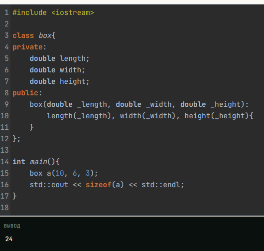

# Языки программирования
## Лабораторная работа 12

**Первые шесть заданий требуется выполнить на языке С++.**
### Задание 1 **(2)**

*Запишите класс* **box** *с тремя скрытыми полями типа с плавающей
точкой:* **length**, **widht**, **height**. *Добавьте в класс инициализирующий
конструктор. Найдите размер одного объекта этого класса с
использованием* **sizeof**.

**Решение**



**Пояснение:**

Размер объекта `a` класса `box` равен **24 байтам**. Это объясняется тем, что размер экземпляра класса в C++ складывается исключительно из размеров его нестатических полей (переменных):

* В классе объявлены три поля типа `double`: `length`, `width` и `height`.
* На большинстве современных архитектур тип `double` занимает в памяти **8 байт**.
* Итоговый размер вычисляется как $3 \times 8 = 24$ байта (выравнивание памяти в данном случае не добавляет пустых байтов, так как все поля имеют одинаковый размер).

Конструктор, методы и модификаторы доступа (`private`, `public`) хранятся в сегменте кода программы отдельно от данных и никак не увеличивают размер конкретного объекта в памяти.

---

### Задание 2 **(2)**

*Добавьте в класс методы для вычисления объема коробки и
площади поверхности всех граней. Напишите программу, тестирующую
работу методов. Проверьте, изменился ли размер одного объекта этого
класса. Объясните результат*

**Решение**

```cpp
#include <iostream>

class box{
private:
    double length;
    double width;
    double height;
public:
    box(double _length, double _width, double _height):
        length(_length), width(_width), height(_height){
    }
    double volume();
    double surface();
};

double box::volume(){
    return length * width * height;
};
double box::surface(){
    return 2 * (length * width + length * height + width * height);
};

int main(){
    box a(10, 6, 3);
    std::cout << "Object size = " << sizeof(a) << std::endl;
    std::cout << "Volume = " << a.volume() << std::endl;
    std::cout << "Surface = " << a.surface() << std::endl;
}
```

**Вывод** 

*Object size = 24
Volume = 180
Surface = 216*

---

### Задание 3 **(2)**

*Создайте два объекта* **x** *и* **y** *класса* **box** *в куче. Напишите
программу, для проверки работы методов, которая будет использовать
оба объекта. Не забывайте, что объекты созданные в куче следует
освобождать.*


### Задание 4 **(2)**

*Добавьте в класс одно статическое поле и метод для вывода
адресов всех четырех полей. Создайте три объекта этого класса в
куче, в статической памяти и на стеке. Выведите адреса полей.
Объясните результат.*

### Задание 5 **(2)**

*Напишите программу, которая продемонстрирует разницу между
присваиванием* ```x=y``` *и* ```*x=*y```.


### Задание 6 **(3)**

*Запишите класс* **rational** *(рациональное число, представленное в
виде дроби).*
```
class rational {
private :
    long long nom;
    unsigned long long denom;
};
```
*Добавьте в класс конструкторы так, чтобы:*

* *по умолчанию дробь инициализировалась как* ```0/1```;
* *работала инициализация* ```rational r = 3;```
* *работала инициализация* ```rational r(-2, 3);```
* *работала инициализация* ```rational t = r;```

### Задание 7 **(2)**

*Напишите программу на Python в которой будет определяться
класс* **Point** *с двумя полями* **x** *и* **y**. *Класс должен содержать
конструктор и метод* **__str__** *для создания текстового представления
точки. 

Напишите программу для проверки работы методов.*

### Задание 8 **(2)**

*Напишите программу на Python в которой будет определяться класс*
**Rectangle** *с двумя полями типа* **Point**. *Точки задают левый верхний
и правый нижний угол прямоугольника. Класс должен содержать
конструктор и метод* **__str__** *для создания текстового представления
прямоугольника. 

Напишите программу для проверки работы методов.*

### Задание 9 **(2)**

*Добавьте в класс функцию для вычисления площади
прямоугольника. Функцию следует добавить не в момент
определения класса, а в процессе работы программы.*

*Проверьте работоспособность функции.*

### Задание 10 **(2)**

*Добавьте в программу класс* **Segment** *с двумя полями типа*
**Point**. *Точки задают концы отрезка. Класс должен содержать
конструктор, метод* **__str__** *для создания текстового представления
отрезка и метод* **length** *для нахождения длины отрезка.*

*Напишите программу для проверки работы методов.*

*Измените тип ранее созданного объекта класса* **Rectangle** *на* **Segment**.
*Объект должен создаваться с типом* **Rectangle**, *а после изменить тип
на* **Segment**.

*Проверьте работу методов до и после изменения типа.*


## Дополнительные задания

### Задание 1 **(20)**

*Напишите на языке С++ класс* **matrix** для работы с матрицами квадратного вида. Напишите методы для нахождения 
определителя матрицы, для сложения и умножения матриц, для умножения матрицы на число.

